<div align="center">

# 🎓 EduConnect

**The official website and digital campus for any school, institute or university — ready to deploy in one command.**

[](https://github.com/yahyahouimdi/educonnect/actions/workflows/ci.yml)


</div>

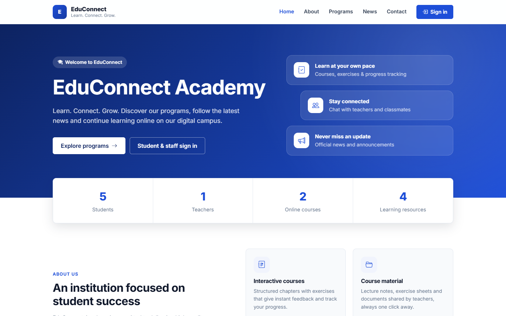

EduConnect is a **white-label** platform: the institution's name, logo, colors, contact details and content are
configured from the admin console (or environment variables), so the same build can power the official website of
any institution — no code changes required.

It combines, in a single application:

| | |
|---|---|
| 🌐 **Public website** | Home page, about, programs catalog, news & announcements, contact form |
| 📚 **E-learning** | Courses → chapters (Markdown) → exercises with instant feedback, progress tracking and chapter unlocking |
| 📁 **Resources** | Teachers share documents (PDF, slides, sheets…) that students download |
| 💬 **Real-time chat** | WebSocket chat rooms for the whole institution and for every course |
| ✨ **AI teaching assistant** | Optional Gemini-powered assistant; the API key never leaves the server |
| 🛠️ **Admin console** | Users & roles, courses, news, contact inbox, institution branding |

---

## Table of contents

- [Quick start](#-quick-start)
- [Make it yours](#-make-it-yours)
- [Screenshots](#-screenshots)
- [Features](#-features)
- [Architecture](#-architecture)
- [Configuration](#-configuration)
- [Local development](#-local-development)
- [Testing](#-testing)
- [API documentation](#-api-documentation)
- [Deploying to production](#-deploying-to-production)
- [Project structure](#-project-structure)
- [License](#-license)

---

## 🚀 Quick start

**Requirement:** [Docker](https://docs.docker.com/get-docker/) with Docker Compose v2. Nothing else — no Java, Node or
MySQL installation needed.

```bash
git clone https://github.com/yahyahouimdi/educonnect.git
cd educonnect
docker compose up -d --build
```

Open **http://localhost:8080** — that's it. The first build takes a few minutes; subsequent starts take seconds.

On first start the database schema is created automatically, along with an administrator account and a small demo
catalog so you can explore every feature right away:

| Role | Email | Password |
|---|---|---|
| Administrator | `admin@educonnect.local` | `Admin@12345` |
| Teacher (demo) | `teacher@educonnect.local` | `Teacher@12345` |
| Student (demo) | `student@educonnect.local` | `Student@12345` |

> [!WARNING]
> These defaults are for evaluation only. Before going live, follow [Deploying to production](#-deploying-to-production).

Useful commands:

```bash
docker compose logs -f backend   # follow the API logs
docker compose ps                # service health
docker compose down              # stop (data is kept in Docker volumes)
docker compose down -v           # stop and delete all data
```

---

## 🎨 Make it yours

1. Copy the configuration template and set your institution's details:

   ```bash
   cp .env.example .env
   ```

   ```dotenv
   INSTITUTION_NAME=Higher Institute of Applied Sciences
   INSTITUTION_SHORT_NAME=HIAS
   INSTITUTION_TAGLINE=Excellence in engineering education
   INSTITUTION_PRIMARY_COLOR="#0f766e"
   ADMIN_EMAIL=it@your-institute.edu
   ADMIN_PASSWORD=a-long-unique-password
   DEMO_DATA=false
   ```

2. Start the stack: `docker compose up -d --build`.
3. Sign in as administrator and open **Administration → Settings** to upload your logo, write the *About* text, and add
   contact details and social links. Changes apply instantly across the whole site — the color palette, favicon and
   page titles are all derived from these settings.
4. Create teacher and student accounts in **Users**, then let teachers build their courses.

> The `INSTITUTION_*` variables only seed the settings on the very first start; afterwards, the admin console is the
> source of truth.

---

## 📸 Screenshots

| Public website | Programs catalog |
|---|---|
|  | 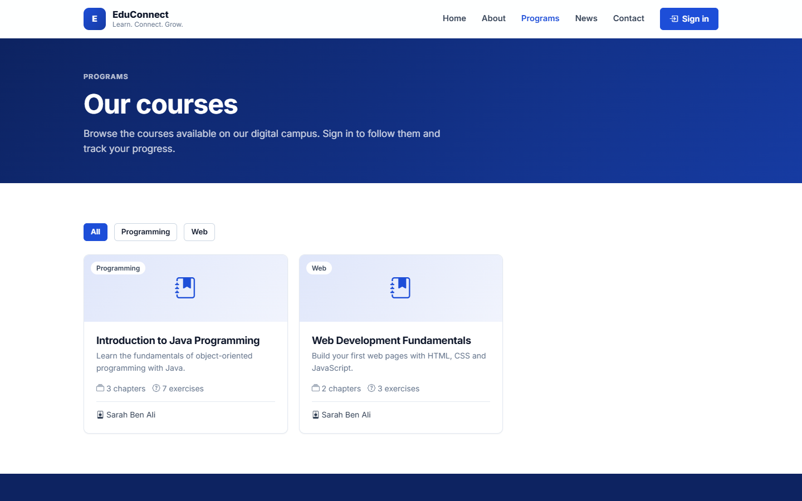 |
| **Course page** | **Sign in** |
| 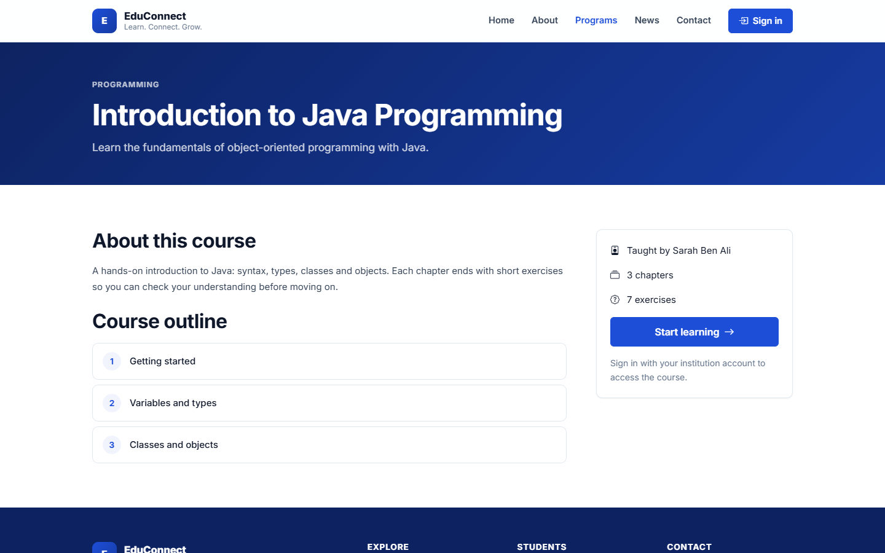 | 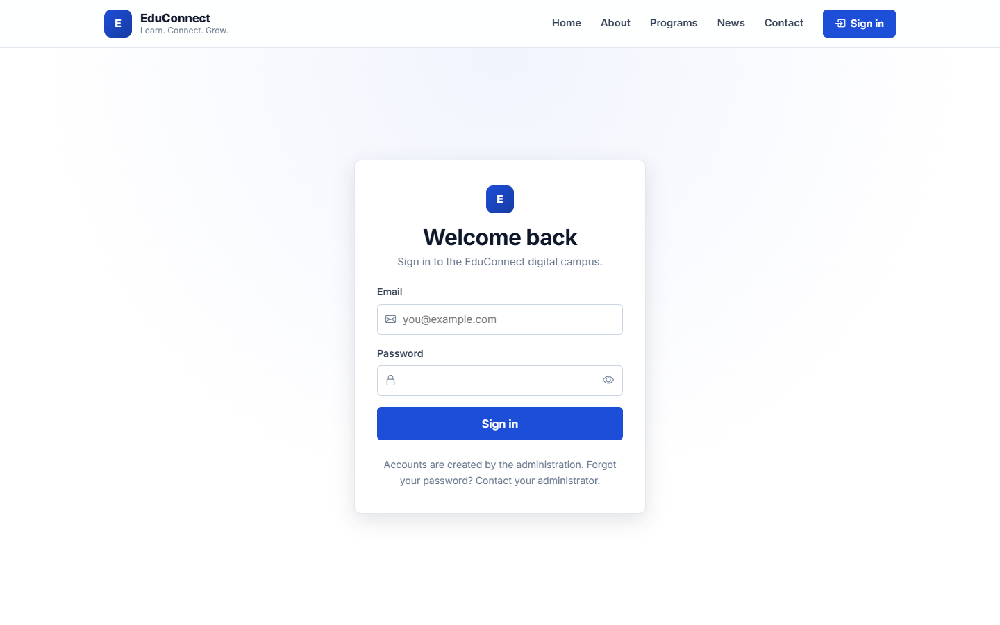 |
| **Student dashboard** | **Course player with exercises** |
| 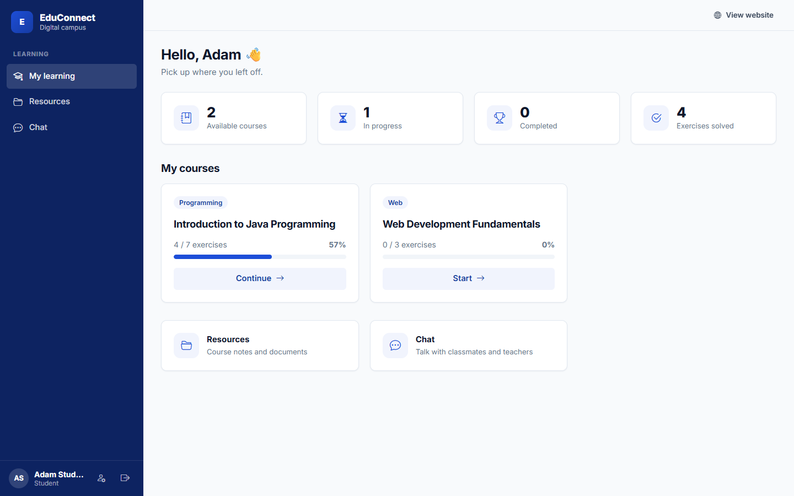 | 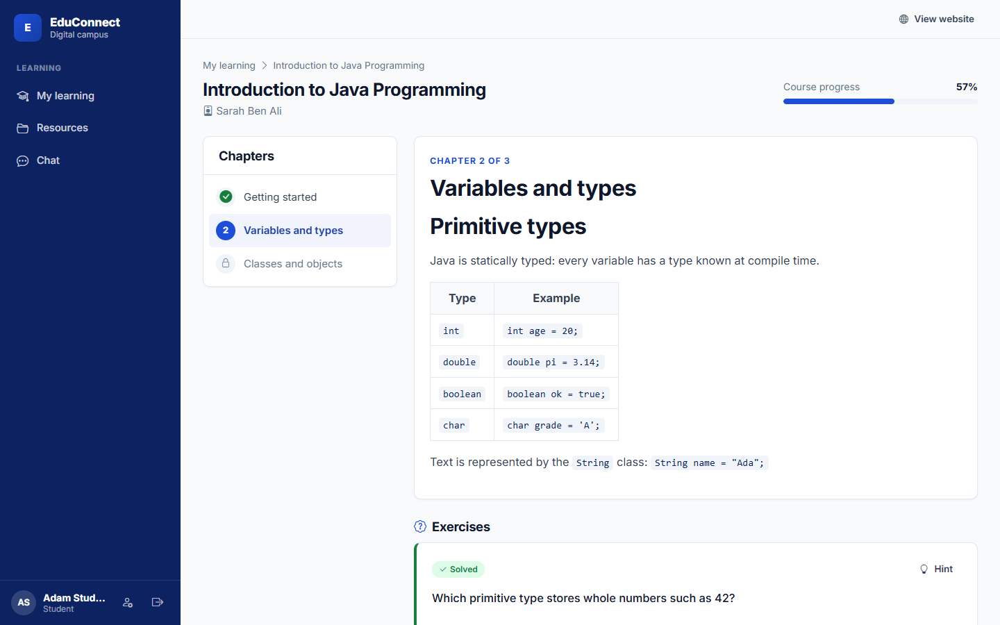 |
| **Real-time chat** | **Resources** |
| 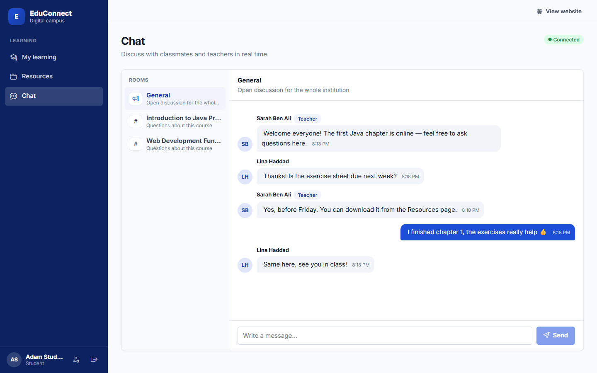 | 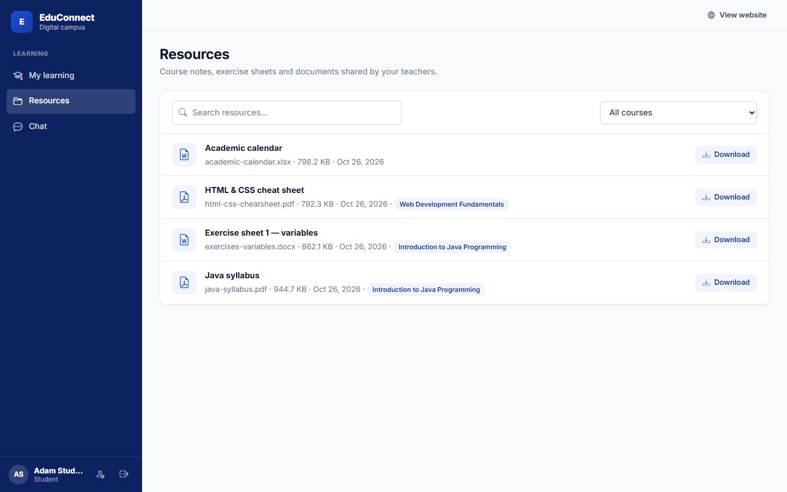 |
| **Admin overview** | **Course editor** |
| 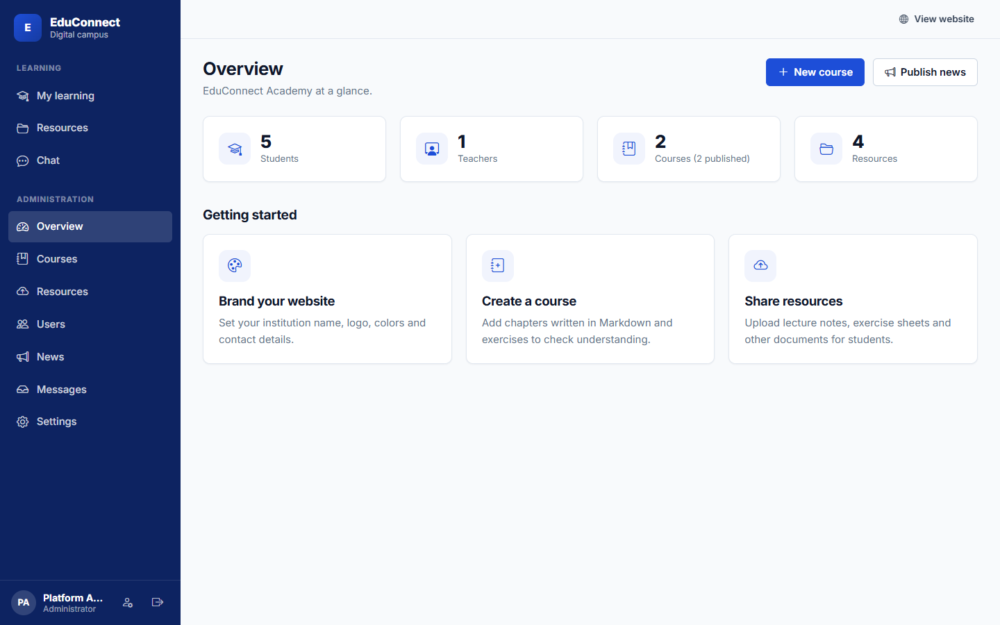 | 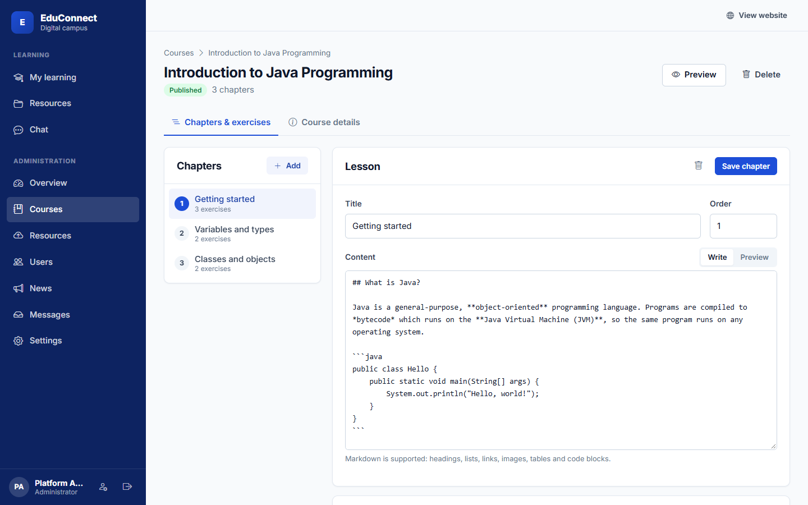 |
| **User management** | **Institution branding** |
| 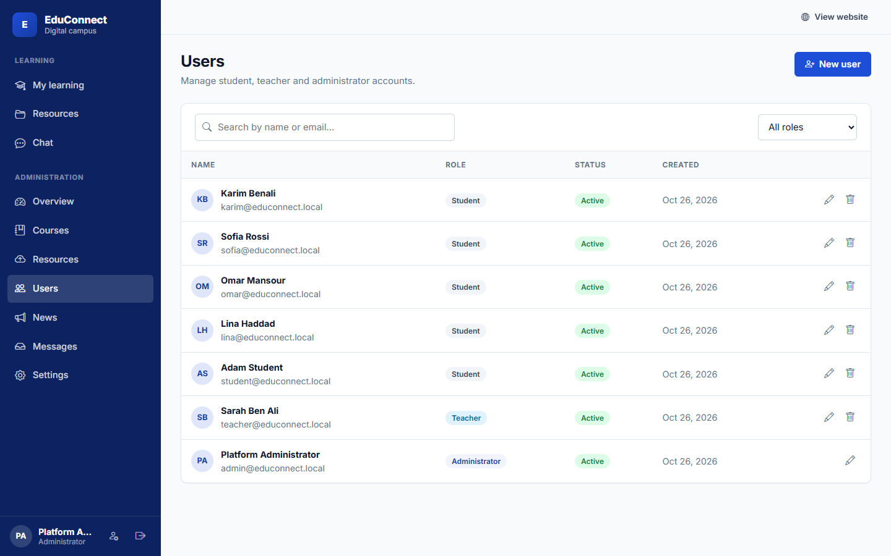 | 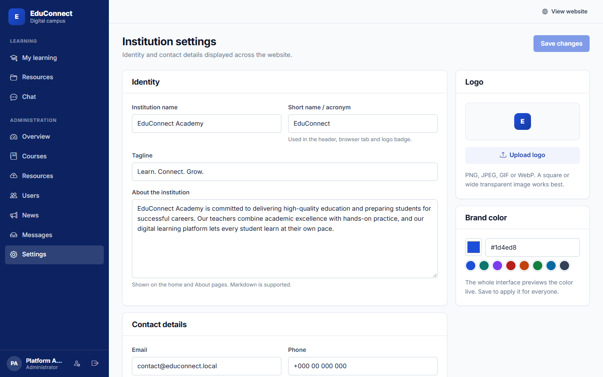 |

<p align="center">
  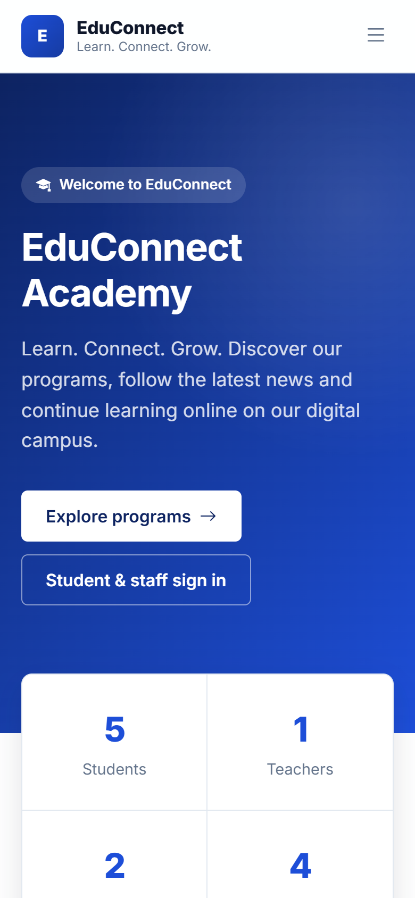
  &nbsp;&nbsp;
  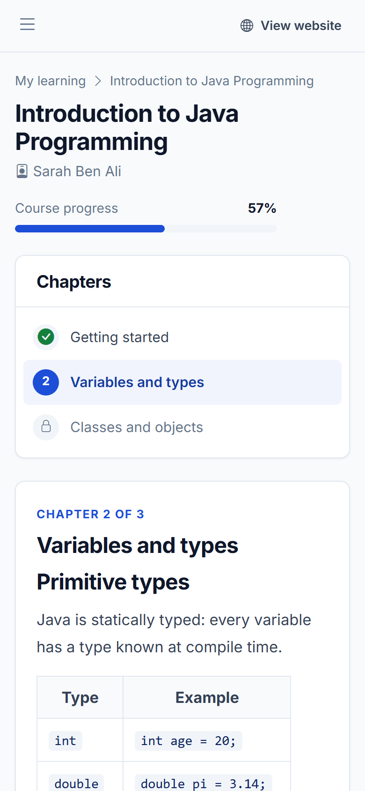
  <br/><em>Fully responsive on phones and tablets</em>
</p>

---

## ✨ Features

### Public website
- Responsive, accessible pages: home (hero, key figures, featured courses, latest news), about, programs, news, contact.
- Contact form with server-side validation and a honeypot against spam bots; messages land in the admin inbox.
- Branding (name, logo, palette, contact info, social links) loaded at runtime — one build for every institution.

### Learning space (students, teachers, admins)
- Course player with Markdown lessons (code blocks, tables, images), exercises and hints.
- Answers are checked **on the server** (the expected answer is never sent to the browser); matching ignores case,
  accents, extra spaces and trailing punctuation, and supports alternatives (`JVM|Java Virtual Machine`).
- Progress per course; the next chapter unlocks once every exercise of the current one is solved.
- Resource library with search and course filter.
- Real-time chat: a general room plus one room per published course, with persisted history.
- AI assistant (optional) with conversation context.

### Administration console
- **Roles:** `ADMIN` (everything), `TEACHER` (own courses and resources), `STUDENT` (learning space).
- Users: search, filter, create, edit, disable (takes effect immediately, even for already issued tokens), delete.
- Courses: drafts/publishing, ordering, teacher assignment, chapter editor with live Markdown preview, exercises.
- News: Markdown editor with side-by-side preview, drafts and publishing.
- Inbox for contact messages (read/unread, reply by email).
- Institution settings with live brand-color preview and logo upload.

---

## 🏗 Architecture


> 📐 **Full design documentation in [docs/ARCHITECTURE.md](docs/ARCHITECTURE.md):** use-case diagram, UML class
> diagram, database ERD, sequence diagrams (authentication, exercises, chat), backend layers, frontend structure,
> CI/CD pipeline and design decisions.

- **Single origin:** Nginx serves the Angular build and reverse-proxies `/api` and `/ws`, so there is no CORS to
  configure in production and the WebSocket shares the same host.
- **Stateless auth:** JWT bearer tokens (HS256). The user is reloaded on each request, so disabling an account or
  changing its role is effective immediately. Passwords are hashed with BCrypt.
- **Database migrations** with Flyway; Hibernate only validates the schema.
- **Errors** follow [RFC 9457 problem details](https://www.rfc-editor.org/rfc/rfc9457) with per-field validation messages.
- **Uploads** are stored on a Docker volume under random names; user-supplied file names never touch the disk.

### Tech stack

| Layer | Technologies |
|---|---|
| Frontend | Angular 20 (standalone components, signals, lazy routes), TypeScript (strict), SCSS design system, Bootstrap Icons, marked, STOMP.js |
| Backend | Java 17, Spring Boot 3.5 (Web, WebSocket, Security, Data JPA, Validation, Actuator), JJWT, springdoc-openapi, Lombok |
| Data | MySQL 8.4, Flyway |
| Ops | Docker multi-stage builds, Docker Compose, Nginx, GitHub Actions (tests + images to GHCR) |

---

## ⚙️ Configuration

All settings are environment variables (see [`.env.example`](.env.example)). The most important ones:

| Variable | Default | Description |
|---|---|---|
| `APP_PORT` | `8080` | Port the website is published on |
| `INSTITUTION_NAME`, `INSTITUTION_SHORT_NAME`, `INSTITUTION_TAGLINE` | EduConnect Academy… | Initial identity (editable in the console) |
| `INSTITUTION_EMAIL`, `INSTITUTION_PHONE`, `INSTITUTION_ADDRESS` | placeholders | Initial contact details |
| `INSTITUTION_PRIMARY_COLOR` | `#1d4ed8` | Initial brand color |
| `ADMIN_EMAIL`, `ADMIN_PASSWORD`, `ADMIN_NAME` | `admin@educonnect.local` / `Admin@12345` | First administrator, created when no admin exists |
| `DEMO_DATA` | `true` | Seed a demo teacher, student, courses and news into an empty database |
| `JWT_SECRET` | dev value | **Required in production.** HMAC key, at least 64 characters |
| `JWT_EXPIRATION` | `PT12H` | Session lifetime (ISO-8601 duration) |
| `DB_NAME`, `DB_USERNAME`, `DB_PASSWORD`, `DB_ROOT_PASSWORD` | `educonnect`… | MySQL credentials |
| `UPLOAD_MAX_FILE_SIZE` / `UPLOAD_MAX_BODY_SIZE` | `50MB` / `50m` | Upload limit (backend / Nginx) |
| `AI_API_KEY` | *(empty)* | Google Gemini key; the assistant is hidden when empty |
| `AI_MODEL` | `gemini-2.5-flash` | Gemini model name |
| `CORS_ALLOWED_ORIGINS` | `http://localhost:4200` | Extra allowed origins (only for a separately hosted frontend) |

---

## 💻 Local development

Prerequisites: **JDK 17+**, **Node.js 20.19+ / 22**, Docker (for MySQL).

```bash
# 1. Database only (exposed on localhost:3306)
docker compose -f docker-compose.yml -f docker-compose.dev.yml up -d db

# 2. Backend on http://localhost:8080 (uses the defaults in application.yml)
cd backend
./mvnw spring-boot:run          # Windows: mvnw.cmd spring-boot:run

# 3. Frontend on http://localhost:4200 with hot reload (proxies /api and /ws to :8080)
cd frontend
npm install
npm start
```

Code style: the frontend uses Prettier (`npm run format`); `.editorconfig` covers the rest.

---

## 🧪 Testing

```bash
cd backend && ./mvnw verify      # unit + integration tests (H2 in MySQL mode, real WebSocket server)
cd frontend && npm test          # Karma/Jasmine (use `npm run test:ci` for headless runs)
```

The backend suite covers authentication and role checks, the full learning flow (answers, progress), teacher
ownership rules, uploads/downloads, site settings validation, the contact form and real-time chat over STOMP.

Every push and pull request runs both suites in GitHub Actions; pushes to `main` and version tags also publish the
Docker images to the GitHub Container Registry (`ghcr.io/<owner>/educonnect-backend` and `…-frontend`).

---

## 📖 API documentation

Interactive OpenAPI documentation is available while the app runs:

- Swagger UI: **http://localhost:8080/api/swagger-ui/index.html**
- OpenAPI JSON: `http://localhost:8080/api/docs`

Authenticate with `POST /api/v1/auth/login`, then click **Authorize** and paste the `accessToken`.

| Area | Base path | Access |
|---|---|---|
| Site, news, courses catalog, contact | `/api/v1/site`, `/api/v1/news`, `/api/v1/courses`, `/api/v1/contact` | Public |
| Auth & profile | `/api/v1/auth` | Public login, then authenticated |
| Learning, resources, chat, assistant | `/api/v1/learning`, `/api/v1/resources`, `/api/v1/chat`, `/api/v1/assistant` | Authenticated |
| Courses, resources, dashboard | `/api/v1/admin/courses`, `/api/v1/admin/chapters`, `/api/v1/admin/resources` | Admin, Teacher |
| Users, news, settings, inbox | `/api/v1/admin/users`, `/api/v1/admin/news`, `/api/v1/admin/site`, `/api/v1/admin/contact-messages` | Admin |
| Chat (STOMP) | `/ws` — send `/app/chat/{room}`, subscribe `/topic/rooms/{room}` | Bearer token in the CONNECT frame |

---

## 🌍 Deploying to production

1. **Secrets** — in `.env`, set a strong `ADMIN_PASSWORD`, unique `DB_PASSWORD`/`DB_ROOT_PASSWORD`, and a random
   `JWT_SECRET` (`openssl rand -base64 64`). Set `DEMO_DATA=false`.
2. **HTTPS** — put the stack behind a TLS-terminating reverse proxy (Caddy, Traefik, Nginx, a cloud load balancer)
   pointing at `APP_PORT`. WebSockets must be allowed on `/ws`.
3. **Backups** — back up the `db-data` (MySQL) and `uploads` (files) volumes, e.g. with
   `docker compose exec db mysqldump -u root -p educonnect > backup.sql`.
4. **Updates** — `git pull && docker compose up -d --build`. Database migrations run automatically on start.
5. **Pre-built images** (optional) — set `IMAGE_REGISTRY=ghcr.io/<owner>` and `IMAGE_TAG`, then
   `docker compose pull && docker compose up -d`.

Health endpoint for monitoring: `GET /actuator/health` on the backend container (used by the Docker health checks).

---

## 🗂 Project structure

```
educonnect/
├── backend/                       Spring Boot API
│   ├── src/main/java/io/educonnect/
│   │   ├── auth/                  login, current user, password change
│   │   ├── user/                  users, roles, admin user management
│   │   ├── course/                courses, chapters, exercises, progress, answer matching
│   │   ├── resource/              uploaded learning resources
│   │   ├── news/                  news & announcements
│   │   ├── site/                  institution settings (branding), stats, dashboard
│   │   ├── contact/               public contact form & inbox
│   │   ├── chat/                  STOMP chat rooms and history
│   │   ├── assistant/             AI assistant (Gemini) proxy
│   │   ├── security/ config/      JWT, Spring Security, WebSocket, OpenAPI, bootstrap data
│   │   └── common/ storage/       errors, paging, file storage
│   ├── src/main/resources/db/migration/   Flyway migrations
│   └── Dockerfile
├── frontend/                      Angular application
│   ├── src/app/
│   │   ├── core/                  API clients, auth, guards, interceptor, theming, chat socket
│   │   ├── shared/                reusable UI (modal, pager, brand, pipes)
│   │   ├── layout/                public website & workspace shells
│   │   └── features/              public/, learn/, admin/ pages (lazy loaded)
│   ├── nginx/                     production Nginx config (SPA + reverse proxy)
│   └── Dockerfile
├── docs/                          architecture docs, UML/ERD diagrams (Mermaid + PNG), screenshots
├── docker-compose.yml             full stack (db, backend, frontend)
├── docker-compose.dev.yml         exposes ports for local development
├── .env.example                   configuration template
└── .github/workflows/ci.yml       tests, builds and image publishing
```

---

## 📄 License

[MIT](LICENSE) © 2026 Yahya Houimdi and EduConnect contributors.
