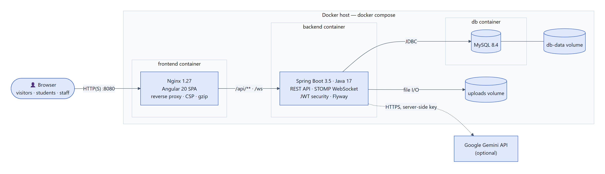
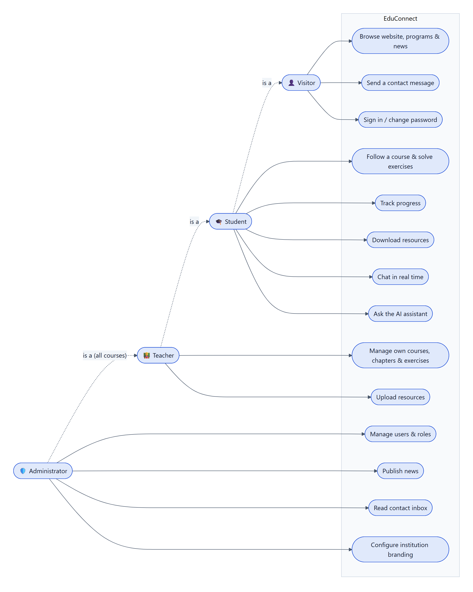
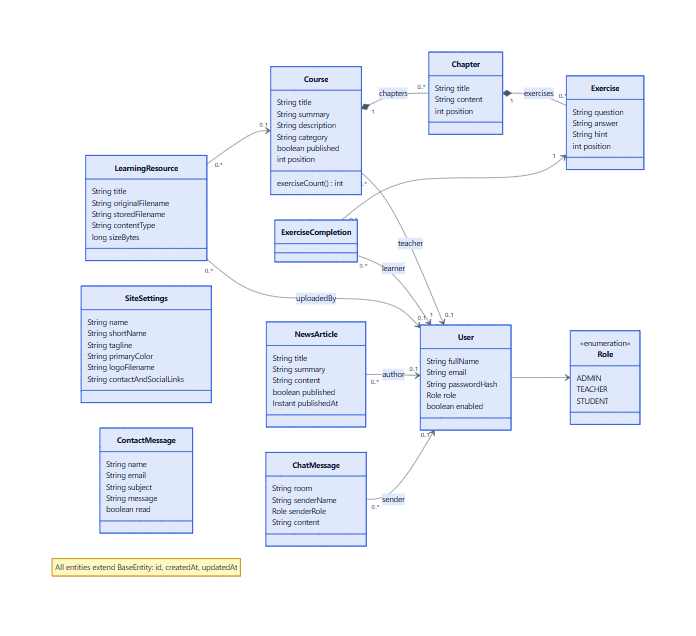
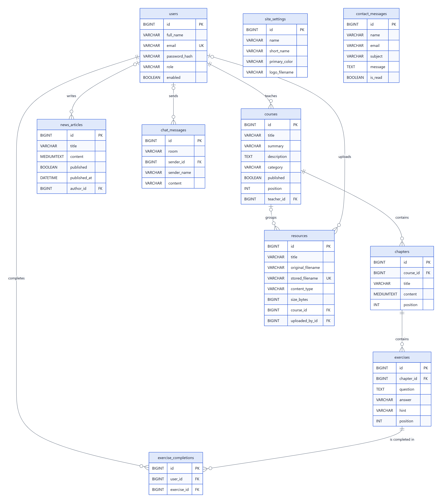
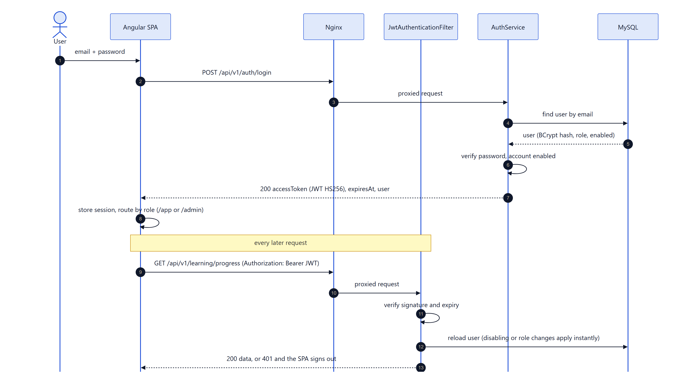
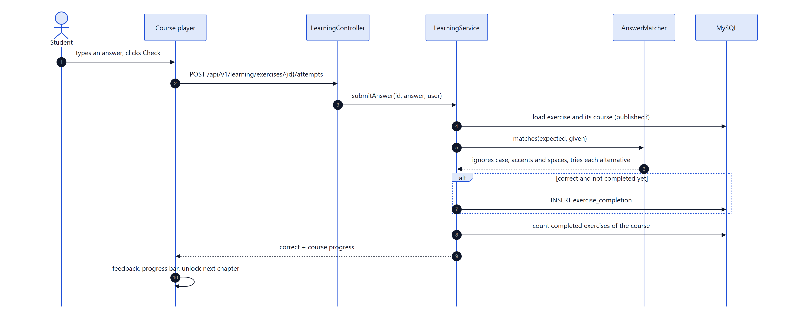
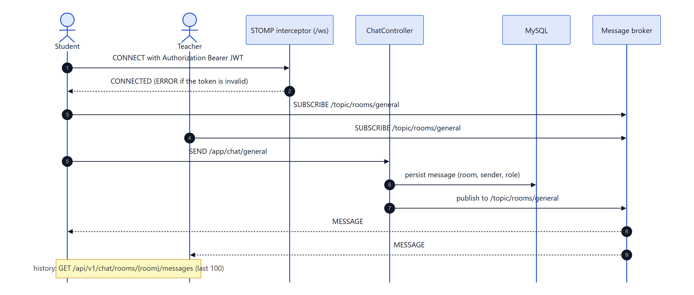
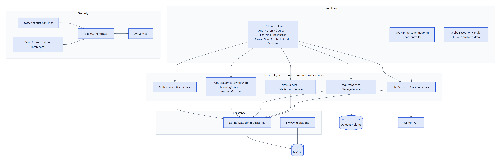
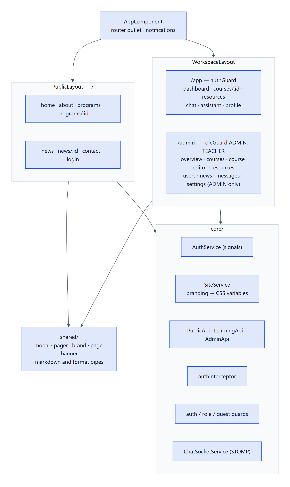
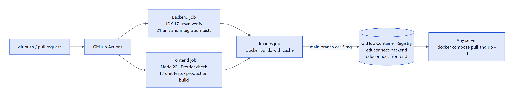

# EduConnect — Architecture & design

This document explains how EduConnect is built: deployment, functional scope, domain model, database,
key runtime flows and the internal structure of the backend and frontend.

Diagram sources live in [`docs/diagrams/*.mmd`](diagrams) ([Mermaid](https://mermaid.js.org)); the PNG next to each
file is the rendered version. Edit the source, then re-render (any Mermaid tool, e.g.
`npx @mermaid-js/mermaid-cli -i 01-architecture.mmd -o 01-architecture.png`).

## Contents

1. [Deployment architecture](#1-deployment-architecture)
2. [Use cases](#2-use-cases)
3. [Domain model (UML class diagram)](#3-domain-model)
4. [Database schema](#4-database-schema)
5. [Authentication flow](#5-authentication-flow)
6. [Answering an exercise](#6-answering-an-exercise)
7. [Real-time chat](#7-real-time-chat)
8. [Backend layers](#8-backend-layers)
9. [Frontend structure](#9-frontend-structure)
10. [CI/CD pipeline](#10-cicd-pipeline)
11. [Design decisions](#11-design-decisions)

---

## 1. Deployment architecture

Three containers orchestrated by Docker Compose. Only the frontend container publishes a port: Nginx serves the
Angular build and reverse-proxies `/api/**` and `/ws` to the backend, so the browser talks to a **single origin**.
MySQL and uploaded files live in named volumes and survive upgrades. The AI assistant calls the Gemini API from the
server, so the API key is never exposed to browsers.

## 2. Use cases

Roles are cumulative: a student can do everything a visitor can, a teacher everything a student can, and an
administrator everything a teacher can — on **all** courses, whereas teachers only manage courses assigned to them.

## 3. Domain model

- A `Course` is composed of ordered `Chapter`s (Markdown lessons), each composed of ordered `Exercise`s.
  Deleting a course cascades to its content and to the related progress.
- `ExerciseCompletion` records that a learner solved an exercise; course progress is derived from it, never stored.
- `SiteSettings` is a single row holding the institution identity, which makes the platform white-label.
- `ChatMessage` keeps a denormalised sender name and role so history stays readable after an account is deleted.

## 4. Database schema

The schema is owned by Flyway ([`V1__initial_schema.sql`](../backend/src/main/resources/db/migration/V1__initial_schema.sql));
Hibernate only validates it at startup. Foreign keys use `ON DELETE CASCADE` for owned content and
`ON DELETE SET NULL` for authorship, so removing a user never deletes institutional content.

## 5. Authentication flow

Stateless JWT (HS256) authentication with BCrypt password hashing. The filter reloads the user for each request:
one primary-key lookup buys immediate effect for account disabling and role changes, without a token blacklist.

## 6. Answering an exercise

Answers are always checked server-side — the expected answer is never part of the learner API. `AnswerMatcher`
normalises case, accents (Unicode NFD), whitespace and trailing punctuation and accepts `|`-separated alternatives.

## 7. Real-time chat

STOMP over a plain WebSocket. The STOMP `CONNECT` frame carries the same bearer token as REST calls and is validated
by a channel interceptor; `SEND`/`SUBSCRIBE` without an authenticated session are rejected. Messages are persisted
before being broadcast, and rooms are derived from the catalog (one general room plus one per published course).

## 8. Backend layers

Package-by-feature (`auth`, `user`, `course`, `resource`, `news`, `site`, `contact`, `chat`, `assistant`), each with
controller → service → repository layers. Controllers are thin; transactions and business rules (ownership checks,
progress, publishing) live in services. All errors become RFC 9457 problem details in one `GlobalExceptionHandler`.

## 9. Frontend structure

Standalone Angular components, signals for state, lazily loaded pages and functional guards/interceptors.
`SiteService` loads the branding before the first render and turns the brand color into CSS custom properties, so a
single build adapts to any institution.

## 10. CI/CD pipeline

## 11. Design decisions

| Decision | Rationale |
|---|---|
| Single repository (monorepo) for backend, frontend and infrastructure | One clone, one version, one `docker compose up` |
| Nginx as the only public entry point | Same-origin API and WebSocket, no CORS configuration in production, security headers and caching in one place |
| Branding stored in the database, seeded from environment variables | Ready for any institution without rebuilding; administrators change it without technical help |
| JWT reloaded against the database on every request | Immediate revocation (disable account, change role) while keeping the API stateless |
| Flyway migrations + Hibernate `validate` | Reviewable, versioned schema changes; startup fails fast on drift |
| Files on a volume under random names, metadata in MySQL | Keeps the database small, prevents path traversal and file-name injection |
| Server-side answer checking | Learners cannot read answers from network traffic |
| Strict Content-Security-Policy (`script-src 'self'`) | Mitigates XSS; Markdown is rendered client-side and sanitised by Angular |
| AI provider called from the backend | API key stays secret; usage can be rate-limited or swapped centrally |
